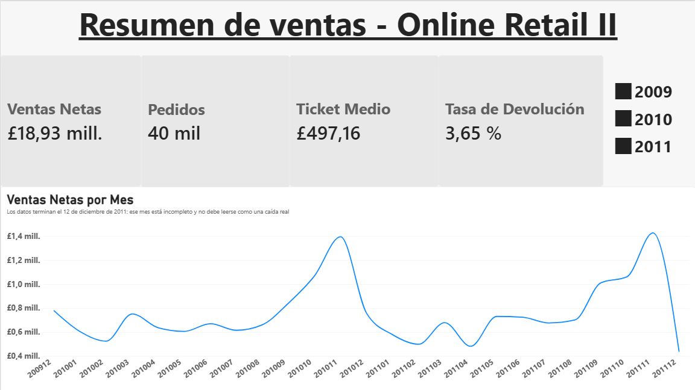
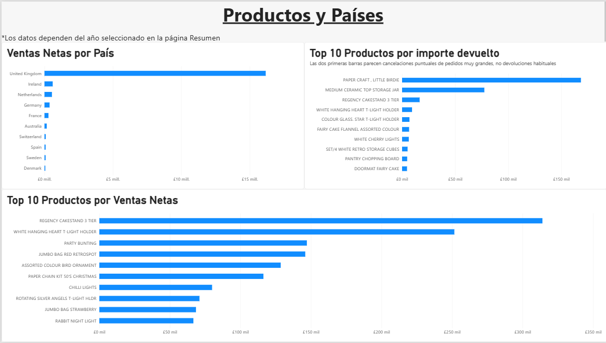

# Análisis de rendimiento retail con Power BI

Proyecto personal para practicar el ciclo completo de análisis de datos:
limpieza, modelado, DAX y un informe en Power BI. Lo planteé desde mi
experiencia y conocimientos trabajando en retail varios años, intentando 
responder a las preguntas que se hace una tienda en el día a día: qué se vende, 
cuándo, a quién y qué se devuelve.

## Objetivo

Responder a preguntas de negocio sobre ventas, productos, mercados y clientes
a partir de datos transaccionales reales.

## Preguntas de negocio y conclusiones

**1. ¿Cómo evolucionan las ventas y qué estacionalidad presentan?**
Las ventas netas suman 18,93 M£ en 40 mil pedidos. Hay un pico claro en noviembre de cada año (en torno a 1,4 M£ en 2010 y en 2011), lo que apunta a una campaña de Navidad o Black Friday, que es algo común en comercio. 2010 es el único año completo: 9,14 M£ y 20 mil pedidos. 2011 llega a 9,01 M£ con unas tres semanas menos de datos, pero no se puede afirmar crecimiento sin comparar los mismos meses de ambos años.

**2. ¿Qué productos generan más ingresos y cuáles acumulan más devoluciones?**
El producto que más vende es el *Regency Cakestand 3 Tier* (unas 315 mil £), seguido de *White Hanging Heart T-Light Holder* (unas 250 mil £). Casi todo el catálogo son artículos de decoración y regalo. En devoluciones, las dos mayores operaciones (168.469,60 £ y 77.183,60 £) son pedidos anulados que se registraron el mismo día o con el mismo importe que la venta, no devoluciones de clientes (ver más abajo).

**3. ¿Qué países pesan más en las ventas?**
El Reino Unido concentra en torno al 85% de las ventas netas (16,17 M£). Le siguen Irlanda, Países Bajos, Alemania y Francia, con cifras mucho menores.

**4. ¿Qué recomendaciones se pueden extraer?**
Son sugerencias basadas en un análisis limitado:
- Planificar stock y campañas pensando en el pico de octubre-noviembre.
- Revisar la dependencia del mercado británico, que concentra la mayor parte del negocio.
- Marcar los pedidos anulados de gran importe para que no distorsionen indicadores como el ticket medio o la tasa de devolución.

## Un hallazgo: la tasa de devolución de 2011

La tasa pasa del 2,54% en 2010 al 4,84% en 2011, pero el aumento no refleja más devoluciones de clientes. Dos operaciones concentran en torno a un tercio del total devuelto (unas 716 mil £). En las dos hay una venta y una cancelación por el mismo importe, y lo comprobé en una tabla con factura, fecha, cantidad e importe. Sin ellas, la tasa de 2011 sería de aproximadamente el 2,3% (estimación), parecida a la de 2010. Las ventas netas no cambian, porque cada venta y su cancelación se compensan, pero sí se inflan las ventas brutas, el ticket medio y la tasa de devolución.

## Cómo se hizo

1. **Auditoría de calidad** en Power Query antes de modificar nada: duplicados, devoluciones, ajustes de stock, precios a cero y códigos que no son producto. Los detalles y las decisiones están en [`notes/limpieza.md`](notes/limpieza.md).
2. **Limpieza:** de 1.067.371 filas originales se pasó a 1.027.016 (se eliminaron duplicados y líneas sin importe de venta). Se añadieron dos columnas para clasificar cada línea: `TipoLinea` (producto, envío, descuento, ajuste) y `TipoMovimiento` (venta o devolución).
3. **Modelo:** tabla de hechos de ventas conectada a una tabla de calendario.
4. **Medidas DAX:** ventas, devoluciones, pedidos, ticket medio y tasa de devolución. Están documentadas en [`notes/medidas.md`](notes/medidas.md).
5. **Informe** de dos páginas con segmentación por año.

## Limitaciones

- Diciembre de 2011 está incompleto (los datos terminan el 12 de diciembre) y 2009 solo tiene diciembre. Solo 2010 es un año completo. Importante a tener en cuenta para los posibles análisis.
- Un 23% de las líneas no tiene identificador de cliente.
- Los datos son de un solo comercio, así que las conclusiones no son generalizables.
- Solo se revisaron a fondo las dos mayores cancelaciones porque eran de un valor muy superior a las demás.

## Próximos pasos

- Análisis de clientes (quiénes son los mejores y cuánto concentran), que no se ha hecho.
- Comparar los mismos meses entre años.
- Revisar si hay más cancelaciones de pedidos grandes con el mismo patrón.

## Resumen del informe

El informe tiene dos páginas.

También hay una versión en PDF: [`docs/informe.pdf`](docs/informe.pdf).

## Datos

- **Fuente:** Online Retail II (UCI Machine Learning Repository)
- **Licencia:** CC0: Public Domain
- **Contenido:** transacciones de un comercio online del Reino Unido,
  2009-2011
- Los datos no se incluyen en este repositorio; descárgalos desde la fuente
  y colócalos en la carpeta `data/`.

## Herramientas

Power BI Desktop (Power Query, modelado, DAX) · Git y GitHub

## Estructura del repositorio

- `data/` datos de origen (no versionados)
- `powerbi/` archivo del informe
- `docs/` capturas y exportaciones
- `notes/` decisiones de limpieza ([ver notas de limpieza](notes/limpieza.md)) y ([ver diccionario de medidas](notes/medidas.md))
